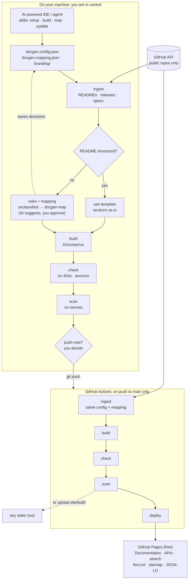

<div align="center" style="text-align: center;">

<h1 align="center" style="text-align: center;"> DocGen</h1>

**Turn public GitHub repositories into a Diátaxis documentation hub: build and check it locally, push, and it goes live.**

[](https://github.com/ICICLE-ai/DocGen/actions/workflows/ci.yml) [](https://nodejs.org) [](https://www.npmjs.com) [](https://git-scm.com) [](https://docusaurus.io) [](https://diataxis.fr) [](#install-the-skills) [](AGENTS.md) [](#your-first-documentation-hub-on-github-pages) [](LICENSE)

[**Tutorials**](#tutorials) · [**How-To Guides**](#how-to-guides) · [**Reference**](#reference) · [**Explanation**](#explanation) · [Citation](#citation) · [Acknowledgements](#acknowledgements)

</div>

DocGen turns the public repositories of a GitHub account, one or more organizations, or a hand-picked list into a single [Docusaurus](https://docusaurus.io/) documentation hub. Every README becomes Overview, Tutorials, How-to, Reference and Explanation pages following [Diátaxis](https://diataxis.fr/), and the hub includes search, release versions, API references, `llms.txt`, a sitemap and schema.org data. Your AI-powered IDE drives the whole process with the bundled agent skills, sorts README sections that need it, and asks before every push. GitHub Actions then deploys the site to GitHub Pages for free.

**Tags:** Software, AI4CI

### License

[](LICENSE)

## References

### Citation

DocGen builds on the design of the ICICLE AI Training Catalog. If you use DocGen, please cite (also available from GitHub's **Cite this repository** button, via [`CITATION.cff`](CITATION.cff)):

> Amit Vyas, Carlos Guzman, Neelima Savardekar, Mary Thomas, Michelle Miller, Alfonzo Morales, Joe Stubbs, Christian Garcia, and Beth Plale. 2026. **A Documentation Catalog for the AI Ecosystem: Design of the ICICLE AI Training Catalog.** *Journal of Computational Science Education* 17, 2 (November 2026), 39–45. [https://doi.org/10.22369/issn.2153-4136/17/2/7](https://doi.org/10.22369/issn.2153-4136/17/2/7)

<details>
<summary><b>BibTeX</b></summary>

```bibtex
@article{vyas2026documentation,
  title   = {A Documentation Catalog for the {AI} Ecosystem: Design of the {ICICLE} {AI} Training Catalog},
  author  = {Vyas, Amit and Guzman, Carlos and Savardekar, Neelima and Thomas, Mary and Miller, Michelle and Morales, Alfonzo and Stubbs, Joe and Garcia, Christian and Plale, Beth},
  journal = {Journal of Computational Science Education},
  volume  = {17},
  number  = {2},
  pages   = {39--45},
  year    = {2026},
  month   = nov,
  doi     = {10.22369/issn.2153-4136/17/2/7}
}
```

</details>

### Related resources

- [Diátaxis](https://diataxis.fr/): the documentation framework DocGen applies (tutorials, how-to guides, reference, explanation), by Daniele Procida.
- [Docusaurus](https://docusaurus.io/): the static site generator behind every hub.
- [Agent Skills](https://agentskills.io): the open skill format used in [`skills/`](skills).
- [`npx skills`](https://github.com/vercel-labs/skills): the CLI that installs the skills into your agent.
- [AGENTS.md](https://agents.md): the agent-neutral instruction file this repo uses ([`AGENTS.md`](AGENTS.md)).
- [GitHub Pages with custom workflows](https://docs.github.com/en/pages/getting-started-with-github-pages/using-custom-workflows-with-github-pages): how the deploy works.
- [`llms.txt`](https://llmstxt.org/) and [schema.org](https://schema.org/): the machine-readable outputs every hub publishes.
- **Key terms.** *Hub*: the generated site. *Ingest*: fetching READMEs, releases and OpenAPI specs from GitHub. *Mapping*: your approved decisions on where non-template README sections go (`docgen.mapping.json`).

## Acknowledgements

DocGen stands on the shoulders of these open-source projects and ideas:

- **[Diátaxis](https://diataxis.fr/)** by Daniele Procida, for the documentation structure and the category definitions used by the `docgen-map` skill.
- **[Docusaurus](https://docusaurus.io/)** (Meta Open Source), with [docusaurus-lunr-search](https://github.com/praveenn77/docusaurus-lunr-search) for offline search and [Mermaid](https://mermaid.js.org/) for diagrams.
- **[Redoc](https://github.com/Redocly/redoc)** (Redocly), for the interactive API explorer.
- **[js-yaml](https://github.com/nodeca/js-yaml)**, for reading YAML OpenAPI specs.
- **[vercel-labs/skills](https://github.com/vercel-labs/skills)** and the **[Agent Skills](https://agentskills.io)** format, for skill installation across agents.
- **[Shields.io](https://shields.io/)**, for the badges.
- **[The ICICLE AI Training Catalog Paper](https://doi.org/10.22369/issn.2153-4136/17/2/7)** and the ICICLE README standard, which inspired DocGen's skill-driven workflow and its README template.

<!-- Please include other funding sources above this line. -->

*National Science Foundation (NSF) funded AI institute for Intelligent Cyberinfrastructure with Computational Learning in the Environment (ICICLE) (OAC 2112606)*

## Contributing

Contributions are welcome. Run `npm test` and `npm run site` before opening one; engine changes need a test in `scripts/test/`.

---

# Tutorials

## Your first documentation hub on GitHub Pages

In this tutorial you'll publish every public repo of your GitHub account to `https://<you>.github.io/my-docs/`, at no cost, with your AI-powered IDE doing the work. It takes about 15 minutes.

### Before you start

| You need | Version | Check with |
|---|---|---|
| **git** | any recent | `git --version` |
| **Node.js** | **≥ 22** (22 or 24 LTS) | `node -v` |
| **npm** | bundled with Node.js | `npm -v` |
| A GitHub account | | |
| An AI-powered IDE or agent that can run commands | Claude Code, Cursor, GitHub Copilot, Codex, Gemini CLI, Windsurf… | |

### 1. Install the DocGen skills

```bash
npx skills add ICICLE-ai/DocGen --skill '*' -g -y
```

This installs six skills for your user, so they work in any folder.

### 2. Ask for a hub

Open your agent in an empty folder and say:

> Create a DocGen documentation hub for my GitHub account.

The agent (`docgen-setup` skill):
1. checks git and Node.js,
2. creates `my-docs/` from the DocGen template (it asks before creating anything on GitHub),
3. runs `npm run list -- <you>` and asks: **all repos, all except some, or only some?**
4. asks for the hub name, banner text, footer, logo and colour, then writes `docgen.config.json`.

### 3. Let it build and check

The agent (`docgen-build` skill) ingests your READMEs. If some sections don't fit a category, it proposes where they go (`docgen-map`) and **you approve the table**. Then it builds the site, runs the **link check** (no broken links, no 404s) and the **leak scan**, and starts a preview at `http://localhost:3000`.

### 4. Approve the push

The agent asks:

> 1. **Push now** · 2. **I'll test first** · 3. **Not yet**

On the first push, the `docgen-deploy` skill creates the public GitHub repo `my-docs`, pushes, and enables **Settings → Pages → Source: GitHub Actions**.

### 5. Watch it go live

The push starts GitHub Actions (**Actions** tab):

```
✓ Preflight   ✓ Ingest READMEs   ✓ Build site   ✓ Link check   ✓ Leak scan   ✓ Deploy
```

About three minutes later, open `https://<you>.github.io/my-docs/`. You now have a hub that says *"Welcome to the Official Documentation Hub for \<your name\>"*, with every repo under **Documentation**, any OpenAPI specs under **APIs**, search, tags and a centered footer with *© 2026 \<you\>*.

> **Tip:** naming the repo `<you>.github.io` serves the hub at `https://<you>.github.io/`.

---

# How-To Guides

## Install the skills

```bash
npx skills add ICICLE-ai/DocGen                            # interactive: choose skills and agents
npx skills add ICICLE-ai/DocGen --list                     # list the skills without installing
npx skills add ICICLE-ai/DocGen --skill '*' -g -y          # all skills, for your user (every project)
npx skills add ICICLE-ai/DocGen --skill docgen-setup       # only the entry point
npx skills add ICICLE-ai/DocGen -a claude-code -a cursor   # specific agents
```

Without `-g`, skills go into the current project. With `-g` they work everywhere, which lets `docgen-setup` start from an empty folder.

<details>
<summary><b>Agents without <code>npx skills</code> support</b></summary>

| Agent | Setup |
|---|---|
| Cursor, GitHub Copilot, OpenAI Codex, Windsurf, Zed, Aider… | Open the DocGen project; they read `AGENTS.md` natively |
| Gemini CLI | Add `{ "contextFileName": "AGENTS.md" }` to `.gemini/settings.json` |
| Claude Code (manual) | Create `CLAUDE.md` containing `@AGENTS.md`, then `mkdir -p .claude && ln -s ../skills .claude/skills` |
| Chat assistants (ChatGPT, Gemini, Claude.ai) | They can't run commands: paste `docgen.schema.json`, ask for a `docgen.config.json`, then follow [Publish without installing anything](#publish-without-installing-anything) |

</details>

## Invoke a skill

Ask in plain language, or type `/<skill-name>` in agents with slash commands.

| Skill | Say something like… | What it does |
|---|---|---|
| [`docgen-setup`](skills/docgen-setup/SKILL.md) **(start here)** | *"Create a docs hub for my GitHub and org acme"* | Checks git and Node.js, **downloads the template** if needed, lists your repos and asks which to publish, collects hub texts and branding, writes the config |
| [`docgen-build`](skills/docgen-build/SKILL.md) | *"Build it and check it"* | Ingest → `docgen-map` if needed → build → **link check** → leak scan → preview → **asks before pushing** |
| [`docgen-map`](skills/docgen-map/SKILL.md) | *"Classify the README sections"* | Sorts sections of non-template READMEs into Diátaxis categories, shows you the table, saves what you approve |
| [`docgen-update`](skills/docgen-update/SKILL.md) | *"Pull in the latest commits and releases"* | Finds what changed upstream, refreshes only that, re-checks, reports, asks before pushing. Also changes the selection or upgrades DocGen |
| [`docgen-deploy`](skills/docgen-deploy/SKILL.md) | *"Put it on GitHub Pages"* | First-time setup: security checklist, repo, first push, Pages, custom domain |
| [`docgen-readme`](skills/docgen-readme/SKILL.md) | *(in a source repo)* *"Restructure this README for DocGen"* | Reorganizes a README into the Diátaxis template without inventing content |

## Publish without installing anything

1. On GitHub, click **Use this template → Create a new repository** (Public).
2. **Settings → Pages → Build and deployment → Source: GitHub Actions.**
3. Edit `docgen.config.json`:
   ```json
   {
     "site": { "title": "My Projects", "name": "Ada Lovelace Lab", "footer": "Supported by the Example Foundation." },
     "source": { "owners": ["your-github-username"] }
   }
   ```
4. Commit. The commit is a push, so it runs the workflow.

In this mode, sections of non-template READMEs are placed by the built-in heading rules only.

## Build from the terminal

```bash
git clone --depth 1 https://github.com/ICICLE-ai/DocGen.git my-docs && cd my-docs
rm -rf .git && git init -b main
npm ci
npm run list -- your-username        # see what you could publish
# edit docgen.config.json
npm run site                         # ingest → build → check → scan
npm run sections                     # any README sections still unclassified?
npm run serve                        # preview at http://localhost:3000
```

## Choose which repos to document

Set `source` in `docgen.config.json`:

| You want | `source` |
|---|---|
| Everything on your personal account | `{ "owners": ["you"] }` |
| Everything in an org | `{ "owners": ["acme"] }` |
| Your account **and** your orgs | `{ "owners": ["you", "acme", "acme-labs"] }` |
| Everything except a few | `{ "owners": ["acme"], "exclude": ["sandbox-*", "acme/old-site"] }` |
| Only repos matching a pattern | `{ "owners": ["acme"], "include": ["ml-*"] }` |
| Only hand-picked repos | `{ "repos": ["you/widget", "acme/gadget"] }` |
| An org plus one outside repo | `{ "owners": ["acme"], "repos": ["partner/plugin"] }` |

Only public repos are used. Forks and archived repos are skipped unless listed or enabled. If two owners have a repo with the same name, the folders become `<owner>-<name>`.

## Classify README sections that don't fit

```text
$ npm run sections
sharkdp/fd @ v10.5.2
  "Benchmark"                        → overview  [UNCLASSIFIED, 34 lines]
  "Integration with other programs"  → overview  [UNCLASSIFIED, 56 lines]
```

Ask your agent *"classify the README sections"* (`docgen-map`), approve its table, or record decisions yourself:

```bash
npm run sections -- set sharkdp/fd "Benchmark=explanation" "Integration with other programs=how-to"
npm run ingest
```

Commit `docgen.mapping.json`. CI reads it to apply the same decisions. To avoid mapping for good, restructure the source README with `docgen-readme` ([template](skills/docgen-readme/templates/README.md)).

## Sync with upstream changes and update the live site

The live site changes **only when you push to `main`**. There is no schedule.

**With your agent:** ask *"pull in the latest"* (`docgen-update`). It shows what's new, changed or removed upstream, refreshes, maps any new sections, rebuilds, checks, reports the differences, and asks before pushing.

**By hand:**

```bash
npm run status                           # what changed upstream since the last build
npm run ingest -- --only owner/a,owner/b # quick local refresh of just those repos (optional)
npm run site                             # full refresh: ingest → build → check → scan
npm run serve                            # review
git commit --allow-empty -m "docs: refresh" && git push   # the push updates the live site
```

| To show… | Do |
|---|---|
| config, branding or mapping changes | commit and push them |
| new README edits, releases or repos from upstream | sync as above, then push (an empty commit is fine when no files changed) |

Every sync rebuilds the generated pages from scratch: new repos are added, changed ones updated, removed ones deleted. See [What a sync changes](#what-a-sync-changes) and ["Last updated" dates](#last-updated-dates).

## Brand the hub

| Part | Set |
|---|---|
| Logo, favicon, banner image, social card | Put files in `branding/` and set `branding.logo` / `favicon` / `banner` / `socialCard` |
| Colour | `branding.primaryColor`. The light and dark palettes are derived from it |
| Heading | `site.name` gives *"Welcome to the Official Documentation Hub for \<name\>"*; `site.heroTitle` replaces it entirely |
| Banner text | `site.description` |
| Footer | `site.copyrightHolder` and `site.footer` |

## Add API documentation

Commit an OpenAPI or Swagger spec named `openapi.*` or `swagger.*` (`.json`, `.yaml`, `.yml`) to the repo, outside tests, examples and `node_modules`. The next build adds an **APIs** menu with a static reference and an interactive explorer. Turn it off with `content.openapi.enabled: false`, or just the explorer with `content.openapi.explorer: false`.

## Host somewhere other than GitHub Pages

Set `site.url` and `site.baseUrl`, run `npm run site`, and upload `site/build/` to Netlify, Vercel, Cloudflare Pages, Firebase, S3 + CloudFront, Azure Static Web Apps, or nginx/Apache. URLs have no trailing slash (`/docs/foo` → `docs/foo.html`), so plain S3 and bare Apache/nginx need a one-line rewrite rule.

## Publish DocGen as a template, then create hubs from it

There are two kinds of repositories. Keep them separate.

| Repo | What it is | Example |
|---|---|---|
| **Template** (one) | DocGen itself: engine, skills, README. Skills are installed from it; hubs are created from it | `ICICLE-ai/DocGen` |
| **Hub** (one per site) | A copy created *from* the template, with its own config, mapping, logo and live site | `ICICLE-ai/icicle-docs`, `<you>/my-docs` |

**Publish the template (once, maintainers).** The template lives at [`ICICLE-ai/DocGen`](https://github.com/ICICLE-ai/DocGen):

```bash
git add . && git commit -m "DocGen: initial release"
git push -u origin main
gh repo edit ICICLE-ai/DocGen --template       # or Settings → General → Template repository
npx skills add ICICLE-ai/DocGen --list         # should list the six docgen-* skills
```

To run your own copy under another account, fork it or push it elsewhere, then replace `ICICLE-ai/DocGen` in `README.md`, `AGENTS.md` and `skills/docgen-setup/SKILL.md`.

The workflow does nothing in the template repo. Its first job sees a template, or the `YOUR-USERNAME-OR-ORG` placeholder, and skips build and deploy (shown as *skipped*, not failed).

**Create a hub (per site):**

```bash
gh repo create <org>/<hub> --template ICICLE-ai/DocGen --public --clone
cd <hub> && npm ci
gh api -X POST repos/<org>/<hub>/pages -f build_type=workflow   # enable Pages (needs admin)
```

Then configure it (ask your agent *"set up DocGen for the <org> org"*, or edit `docgen.config.json`), build and check locally, and push. The site appears at `https://<org>.github.io/<hub>/`. A personal hub works the same way under your account (`gh repo create my-docs --template ICICLE-ai/DocGen --public --clone`).

> Test under a temporary name first. Don't overwrite an existing `<org>.github.io` site. A new hub inherits none of the template's settings or rules; see [Protect the template repository](#protect-the-template-repository-maintainers).

## Protect the template repository (maintainers)

Branch protection lives in **repository settings, which "Use this template" never copies**. Rules on `ICICLE-ai/DocGen` protect DocGen only, and every hub created from it starts with none. Set them up in **Settings → Rules → Rulesets → New ruleset**, **after the first push** (with the branch ruleset active, even the initial commit would need a pull request).

**1. Branch ruleset "Protect main"** (`ICICLE-ai/DocGen`)
- Enforcement status: **Active**. Target branches: **Include default branch**.
- **Restrict deletions** and **Block force pushes**.
- **Require linear history**.
- **Require a pull request before merging**: required approvals **0** (a solo maintainer can merge their own PRs), **require conversation resolution**, allowed merge method **Squash**.
- **Require status checks to pass**: add **`test`** (the job in [`ci.yml`](.github/workflows/ci.yml)) and tick **Require branches to be up to date before merging**. The check appears in the list only after CI has run once, so open one pull request first.

**2. Tag ruleset "Protect release tags"** (`ICICLE-ai/DocGen`)
- Target tags: include pattern **`v*`**.
- **Restrict creations**, **Restrict updates**, **Restrict deletions**, **Block force pushes**.
- Bypass list: **Repository admin**, so only admins can create, move or delete release tags.

**3. Hubs (optional, for hub owners).** A branch ruleset on `main` with **Restrict deletions** and **Block force pushes** only. It still allows the direct push that deploys.

**Also set (Settings):**
- General: allow **squash merging** only, **automatically delete head branches**, wikis off.
- Code security: **Dependabot alerts** and **security updates**, **secret scanning** with **push protection**.
- Actions → General: workflow permissions **read-only**, and require approval for workflows from first-time contributors.

**Adding maintainers later:** add them in Settings → Collaborators and teams, then raise *Required approvals* to 1 in the branch ruleset. No `CODEOWNERS` file is needed, and none is shipped, so hubs never inherit reviewers.

**Automation that ships with the template:**

| File | What it does | In hubs |
|---|---|---|
| [`.github/workflows/ci.yml`](.github/workflows/ci.yml) | On every PR and push to `main`: unit tests, then a sample hub build with link check and leak scan. Provides the required `test` check | Does nothing (runs only in `ICICLE-ai/DocGen` or a template repo); safe to delete |
| [`.github/dependabot.yml`](.github/dependabot.yml) | Weekly grouped PRs for npm packages and GitHub Actions (major versions skipped) | Keeps the hub patched; delete it if you don't want the PRs (merging one redeploys) |

## Use a GitHub token (when and how)

DocGen only reads **public** data, so a token is **optional**. It never gives DocGen access to anything new; it only raises how many requests GitHub lets you make per hour.

**Why GitHub limits requests.** GitHub caps API traffic to protect the service. Anonymous requests are capped hardest because GitHub can't tell who is calling; when you identify yourself with a token, GitHub trusts you with a much bigger allowance:

| Who is calling | Limit | Notes |
|---|---|---|
| Anonymous (no token) | **60 requests/hour** | Counted **per IP address**, so everyone behind the same university, office or VPN network shares those 60 |
| Your personal token | **5,000 requests/hour** | Counted per GitHub account, wherever you are |
| GitHub Actions (`github.token`) | **1,000 requests/hour** | Per repository, created and expired automatically for each run. Nothing to set up |

**How many requests a run needs.** Roughly **4 per repo without releases**, and **1 + 3 per release folder** for repos with releases (README, its last commit and the file tree for each version), plus about 1 per OpenAPI spec and 1–3 per owner listing. Releases dominate: with the default `versions.max: 5`, a repo with 5+ releases costs about 16 requests.

| What you document (default `versions.max: 5`) | Requests per run | Without a token |
|---|---|---|
| 10 repos, no releases | ~42 | ✅ fits in 60 |
| 3 repos, each with 5+ releases | ~50 | ✅ fits, barely |
| 15 repos, no releases | ~62 | ⚠️ just over |
| 10 repos, each with 5+ releases | ~162 | ❌ token needed |
| 50 repos, no releases | ~202 | ❌ token needed |
| 50 repos, each with 5+ releases | ~800 | ❌ token needed (fits easily in 5,000) |

**When to export one:**

| Situation | Token? |
|---|---|
| **GitHub Actions** (every deploy) | **Never needed.** CI uses its built-in token |
| Local build under ~50 requests (see the table: up to ~12 repos without releases, or ~3 with releases) | Not needed |
| Local build above that: a whole org or user account, several repos with releases, or a raised `versions.max` | **Yes** |
| Running `ingest`, `status` or `doctor --online` several times within an hour | **Yes.** Every run spends from the same hourly 60 |
| On a shared network (campus, office, VPN), even for small hubs | **Yes.** Others may already have used the shared 60 |
| You hit `rate limit exceeded` | Yes, or wait for the reset time printed in the error |

`npm run doctor -- --online` estimates the requests for your config and tells you if a token is advisable. If a run does hit the limit, ingest stops before changing anything (your previous output stays intact); export a token or wait, then re-run.

**Get one.** Either option works:

1. **GitHub CLI** (easiest). If you've run `gh auth login`:
   ```bash
   export GITHUB_TOKEN=$(gh auth token)
   ```
2. **Fine-grained personal access token.** Go to GitHub → Settings → Developer settings → Personal access tokens → **Fine-grained tokens** → *Generate new token*. Set **Repository access: Public repositories (read-only)**, give it **no permissions**, and pick a short expiry. Then paste it at a hidden prompt, so it never lands in your shell history:
   ```bash
   read -rs GITHUB_TOKEN && export GITHUB_TOKEN   # paste, press Enter; current terminal only
   ```

Set it **only in your shell**. Never put it in `docgen.config.json`, a `.env` file, a commit or repository secrets: DocGen never needs it there, and `npm run scan` blocks token-shaped strings. `npm run doctor` shows whether a token is present without printing it.

**Tokens and AI agents.** [`AGENTS.md`](AGENTS.md) (rule 1) tells every agent working in this repo to:
- never read `.env`, key or credential files, even to debug;
- never print a token (`echo $GITHUB_TOKEN`, `env`, `printenv`);
- never ask for a token in the chat. If you paste one anyway, it won't be used, and you'll be told to revoke it, because it is now in the conversation log;
- never put a literal token on a command line, in a script or in a config. Agents only run `export GITHUB_TOKEN=$(gh auth token)`, so the value never appears.

Instructions guide an agent; they don't lock anything. For enforcement, also block secret files in your agent's own settings:

| Agent | How to block secret files |
|---|---|
| Claude Code | In `.claude/settings.json` (or your user settings): `"permissions": { "deny": ["Read(./.env)", "Read(./.env.*)", "Read(./**/*.pem)", "Read(./**/*.key)"] }` |
| Cursor | List the files in `.cursorignore` |
| GitHub Copilot | Content exclusion in the repository or organization settings |
| Others | Use the agent's ignore or permission settings, or keep secrets outside the project folder |

The simplest protection is the one DocGen is built around: there is no secret file to protect. Nothing is stored in the repo, and CI uses its own short-lived token.

**Can a token make private repos appear? No.** A token may *see* private repos, but DocGen filters them out:

- Org and user listings keep only repos with `private: false` and `visibility: public`. Internal repos are excluded too.
- A private repo named in `source.repos` is **refused with a warning** and skipped, even if the token can read it.
- If a published repo is made private later, the next build removes it from the site.

> **Want a repo in the hub? Make it public.** It's picked up on the next build and push (if it matches your `source` settings). To hide a public repo, add it to `source.exclude`.

## Troubleshooting

| Symptom | Fix |
|---|---|
| First Actions run fails at *Read GitHub Pages URL* | Pages wasn't enabled yet. Enable it, then **Re-run all jobs** |
| `rate limit exceeded` locally | Use a token: see [Use a GitHub token](#use-a-github-token-when-and-how) |
| `ERROR N repo(s) failed, so nothing was changed` | A fetch failed (network, rate limit, GitHub error). Nothing was overwritten. Re-run; locally, `--keep-going` builds without the failing repo |
| Some README HTML is missing on the site | It was removed by the sanitizer (scripts, iframes, forms, inline SVG, `style`…). Link to the content instead, or use an image |
| Actions shows *build* and *deploy* as **skipped** | Expected in the template repo, or while `docgen.config.json` still has the `YOUR-` placeholder. Configure it and push |
| A repo is missing from the hub | It's private, a fork, archived, excluded, or has no README. `npm run ingest -- --dry-run` shows the selection |
| `npm run check` reports `✖ broken` | A visitor would hit a 404. Fix the source README link or the mapping, then rebuild |
| Search box finds nothing | Search only works on a production build: `npm run build && npm run serve` |
| A section is on the wrong page | `docgen-map`, or `npm run sections -- set …` |

---

# Reference

## Skills

| Skill | Path | Writes |
|---|---|---|
| `docgen-setup` | `skills/docgen-setup/` | project folder, `docgen.config.json`, `branding/` |
| `docgen-build` | `skills/docgen-build/` | commits and pushes (only with your OK) |
| `docgen-map` | `skills/docgen-map/` | `docgen.mapping.json` |
| `docgen-update` | `skills/docgen-update/` | config, mapping, engine files |
| `docgen-deploy` | `skills/docgen-deploy/` | GitHub repo, Pages settings |
| `docgen-readme` | `skills/docgen-readme/` | a *source* repo's `README.md` |

**Run summary.** Every skill ends with a short summary: repos and pages built, sections classified, GitHub API calls used and left, test, link and scan results, what changed and whether it was pushed. It also shows the AI's token usage when the agent can see it. Most agents can't see their own token count, so instead of guessing, the summary names where to check it: `/cost` or `/usage` in Claude Code, `/status` in Codex CLI, `/stats` in Gemini CLI, or the account usage page in Cursor and Copilot.

## Commands

| Command | What it does |
|---|---|
| `npm ci` | Install dependencies |
| `npm run doctor [-- --online]` | Check git, Node.js, npm, config (and GitHub access) |
| `npm run list -- <user> [<org> …]` | List every public repo of those accounts |
| `npm run ingest` | Fetch READMEs and specs; generate `site/docs/`, `site/apis/` |
| `npm run ingest -- --dry-run` / `--only a,b` | Preview the selection / refresh only some repos |
| `npm run ingest -- --keep-going` | Local only: skip a repo that fails to fetch instead of stopping |
| `npm run sections` | Unclassified README sections (`--all`, `--repo owner/name`, `--json`) |
| `npm run sections -- set owner/name "Heading=how-to"` | Record a mapping decision |
| `npm run status` | What changed upstream since the last ingest |
| `npm run build` | Production build to `site/build/` |
| `npm run check [-- --external]` | Link check: **blocks** on broken internal links and missing pages; warns on anchors and external links |
| `npm run scan` | Leak gate |
| `npm run site` | `ingest` + `build` + `check` + `scan` |
| `npm run serve` | Preview the build at http://localhost:3000 |
| `npm test` | Engine unit tests |

## Configuration options

All options live in `docgen.config.json`; [`docgen.schema.json`](docgen.schema.json) documents them and editors autocomplete from it.

| Option | Default | Description |
|---|---|---|
| `source.owners` / `source.repos` | `[]` | Whole accounts / specific repos |
| `source.include` / `exclude` | `[]` | Filter `owners` by glob (`sandbox-*` or `acme/sandbox-*`) |
| `source.includeForks` / `includeArchived` | `false` | Include forks / archived repos |
| `source.versions.enabled` / `max` | `true` / `5` | One folder per GitHub release, newest N |
| `source.versions.includePrereleases` / `includeDefaultBranch` | `false` | Also prereleases / a `next` folder from the default branch |
| `site.title` / `tagline` | — | Navbar title / short line |
| `site.name` | GitHub display name or repo title | Name in *"Welcome to the Official Documentation Hub for \<name\>"* |
| `site.heroTitle` | built from `name` | Replaces the whole heading |
| `site.description` | GitHub description or tagline | Banner text and meta description |
| `site.copyrightHolder` / `footer` | `name` / — | Footer copyright holder / extra centered line |
| `site.url` / `baseUrl` | `"auto"` | Detected on GitHub Pages (custom domains too); set for other hosts |
| `branding.logo` / `favicon` / `banner` / `socialCard` | neutral defaults | File in `branding/` or `https://` URL |
| `branding.primaryColor` | `#2563eb` | Brand colour |
| `content.diataxis` | `"auto"` | `auto` (template → mapping → rules) · `strict` (template only) · `off` (one page) |
| `content.stopAtHeadings` | `[]` | Drop everything from these headings on |
| `content.tagsFromTopics` / `tagsFromReadme` | `true` | Tag sources |
| `content.lastUpdated` | `true` | "Last updated" from the README's last commit |
| `content.openapi.enabled` / `maxPerVersion` / `explorer` | `true` / `3` / `true` | APIs section |
| `content.redactSecrets` | `true` | Replace credential-shaped strings with `[REDACTED]` |

## `docgen.mapping.json`

```json
{
  "repos": {
    "sharkdp/fd": {
      "sections": { "Benchmark": "explanation", "Integration with other programs": "how-to" },
      "readmeCommit": "edc62af…",
      "updatedAt": "2026-11-25"
    },
    "*": { "sections": { "Sponsors": "omit" } }
  }
}
```

Categories: `overview`, `tutorials`, `how-to`, `reference`, `explanation`, `omit`. Headings match case-insensitively; `"*"` applies to every repo; template headings always win.

## Home page, menu and footer

| Part | Shows | Source |
|---|---|---|
| Heading | *Welcome to the Official Documentation Hub for \<name\>* | `site.heroTitle` → `site.name` → GitHub display name → repo title |
| Banner text | Under the heading | `site.description` → GitHub description → `site.tagline` |
| Banner image | Optional background | `branding.banner` |
| Navbar | Logo · **Documentation** · **APIs** (if any) · Tags · GitHub · search | automatic |
| Footer (centered) | Links · *© \<build year\> \<holder\>. All rights reserved.* · your line · last built date | `site.copyrightHolder`, `site.footer` |

## What a sync changes

Each full `npm run ingest`, and every GitHub Actions run, deletes the generated pages and rebuilds them from GitHub. Nothing old lingers.

| Upstream | On the site |
|---|---|
| New public repo matching your `source` settings | New folder added |
| README edited | Pages regenerated with the new content and date |
| New GitHub release | New version folder marked *(latest)*. Older ones shift down; anything past `versions.max` (default 5) drops off |
| OpenAPI spec added or changed | API reference and explorer added or regenerated |
| Nothing changed | Identical pages and dates |
| Repo deleted, made private, archived or excluded | Its folder is removed |
| README heading renamed | That section falls back to the rules; `npm run sections` flags it for re-mapping |

`npm run ingest -- --only a,b` refreshes only those repos locally. Removals only happen in a full run, and CI always runs a full one.

## "Last updated" dates

Every page shows **Last updated**, the date its *content* last changed upstream (not when you synced), plus a link to the exact source commit.

| Page | Date comes from |
|---|---|
| Overview, Tutorials, How-to guides, Reference, Explanation | Last commit that touched **that README at that release** |
| API reference and explorer | Last commit that touched **that spec file** at that release |
| Older version folders | The date as of that release (v1 keeps its older date) |
| Index pages (*All APIs*, folder indexes) | Build date |
| Home page project cards | "Updated" date of each project's latest version |
| Footer | "Last built" date of the whole site |

Turn the dates off with `content.lastUpdated: false`.

## Generated output

Generated folders are gitignored and rebuilt in CI from the same config and mapping.

```text
site/docs/                      site/apis/  (only if a repo has an OpenAPI/Swagger spec)
├── index.md                    ├── index.md
├── widget/                     └── gadget/v2.1.0/
│   ├── overview.md                 ├── reference.md   ← static, searchable
│   └── how-to.md                   └── explorer.mdx   ← interactive
└── gadget/
    ├── v2.1.0/  (latest)  overview · tutorials · reference · explanation
    └── v1.4.2/
```

Every hub also publishes `sitemap.xml`, `robots.txt`, `llms.txt`, `llms-full.txt`, a `.md` copy of every page, and schema.org JSON-LD.

## Project structure

```text
.
├── AGENTS.md                     ← instructions for any AI agent
├── docgen.config.json            ← what to document, texts, branding (you edit)
├── docgen.mapping.json           ← README section decisions (created by docgen-map; committed)
├── docgen.schema.json            ← every option, documented
├── branding/                     ← your logo / favicon / banner
├── scripts/                      ← engine (Node.js standard library + js-yaml)
│   ├── doctor · list · ingest · sections · status · check · scan  (.mjs)
│   ├── lib/   config · github · markdown · openapi · secrets · folders · staging
│   └── test/
├── site/                         ← Docusaurus
│   ├── docusaurus.config.mjs   sidebars.mjs   sidebars-apis.mjs
│   ├── src/pages/index.js        ← hub home page
│   ├── src/components/ApiExplorer.js
│   ├── src/plugins/docgen.mjs    ← llms.txt · JSON-LD · robots · palette
│   └── static/img/               ← neutral default logo, favicon, social card
├── skills/                       ← docgen-setup · build · map · update · deploy · readme
└── .github/
    ├── workflows/deploy.yml      ← on push: ingest → build → check → scan → deploy
    ├── workflows/ci.yml          ← template repo only: tests + sample build on PRs
    └── dependabot.yml            ← weekly dependency PRs
```

---

# Explanation

## Highlights

- **One hub for all your projects**: a personal account, orgs, or hand-picked repos. Each repo gets a folder named after it, and each GitHub release gets its own sub-folder.
- **Diátaxis pages from READMEs**: templated READMEs are used as-is; for the rest, your AI-powered IDE proposes where each section goes and you approve it.
- **You control publishing**: local build, link check and leak scan, then *you* say push. GitHub Actions deploys only on push.
- **APIs from OpenAPI/Swagger**, **"last updated" on every page**, search, tags, `llms.txt`, sitemap and schema.org.
- **Your brand**, with neutral defaults. **Nothing private leaks.**

## Ways to use DocGen

| You want… | How | Notes |
|---|---|---|
| **A hub for your personal account** | Hub repo under your account, `source.owners: ["<you>"]` | `<you>.github.io` serves at the root URL |
| **A hub for an organization or lab** | Hub repo in the org, `source.owners: ["<org>"]` | One versioned folder per repo, APIs included |
| **One hub for you and your orgs** | `owners: ["<you>", "<org>", …]` | Name clashes become `<owner>-<name>` |
| **A curated showcase** | `repos: ["a/x", "b/y"]` only | Repos can come from any owners |
| **Docs for a single project** | `repos: ["<owner>/<project>"]` | Releases become version folders |
| **Several hubs from one template** | One hub repo each (team, lab, product) | Each has its own config, logo and URL |
| **A test hub before going live** | Hub repo under a temporary name; rename later | The URL updates automatically on the next push |
| **AI-assisted (recommended)** | `npx skills add`, then ask your agent | Messy READMEs get mapped; you approve every push |
| **No AI, browser only** | *Use this template* → edit config → commit | Sections placed by heading rules |
| **No AI, terminal** | `npm run site` then `git push` | Map sections with `npm run sections -- set` |
| **Hosting other than GitHub Pages** | `npm run site`, upload `site/build/` | Set `site.url` / `site.baseUrl` |
| **Better source READMEs** | `docgen-readme` in each source repo | Template READMEs need no mapping at all |

See [Publish DocGen as a template, then create hubs from it](#publish-docgen-as-a-template-then-create-hubs-from-it) for the repository setup.

## Architecture



| Layer | Where | Role |
|---|---|---|
| Skills | `skills/`, `AGENTS.md` | Let any agent drive DocGen safely. Never run in CI |
| Your settings | `docgen.config.json`, `docgen.mapping.json`, `branding/` | The only files you edit or approve; committed |
| Engine | `scripts/` | Deterministic Node.js: GitHub → Markdown, section report, link check, leak scan |
| Site | `site/` | Docusaurus with Documentation and APIs, hub home page, and a plugin for llms.txt, JSON-LD, robots and palette |
| Delivery | `.github/workflows/deploy.yml` | On push: the same pipeline, then deploy to Pages |

## How READMEs become pages

Each README is cleaned (front matter and HTML comments removed, secrets redacted, relative links pinned to the release) and split. Each section takes the first rule that applies:

| # | Source | When | Result |
|---|---|---|---|
| 1 | **Template** | The README uses `# Tutorials`, `# How-To Guides`, `# Reference`, `# Explanation` | Used as-is |
| 2 | **Mapping** | `docgen.mapping.json` names the heading | Goes where you approved |
| 3 | **Rules** | The heading matches keywords (Installation → Tutorials, Usage → How-to, License → Overview…) | Placed by rule; tiny rule-made pages fold back into Overview |
| 4 | **Unclassified** | Nothing matched | Stays on Overview and appears in `npm run sections` |

This README follows the template, so DocGen would publish it without any mapping.

**Repos with only an Overview page.** Some READMEs give DocGen nothing to sort into Tutorials, How-to, Reference or Explanation. `npm run ingest`, `npm run sections` and every agent run summary list these repos with a short reason:

| Reason | What to do |
|---|---|
| No headings | Nothing to split. Use `docgen-readme` in the source repo |
| Only an introduction | Fine as is, or add real docs upstream |
| Sections not classified yet | Run `docgen-map`; the AI reads them against the Diátaxis definitions |
| Sections too short for their own page | e.g. a 2-line "Installation". They stay on Overview by design |
| Only "about the project" sections | License, contributing, contact: Overview is the right place |
| Diátaxis splitting turned off | `content.diataxis: "off"` in the config |

## The Diátaxis categories

From [diataxis.fr](https://diataxis.fr/): documentation serves four distinct needs, on two axes, *doing vs. knowing* and *studying vs. working*.

| Category | Oriented to | Serves the reader who is… | Looks like |
|---|---|---|---|
| **Tutorials** | learning | studying: a newcomer acquiring skills | a lesson: a guided, safe sequence of steps to a visible result |
| **How-to guides** | goals | working: competent, with a specific task | directions to solve a real-world problem |
| **Reference** | information | working: needs to look up facts | austere, complete descriptions: options, flags, endpoints, config keys |
| **Explanation** | understanding | studying: stepping back to understand | discussion: context, design decisions, trade-offs, *why* |
| *Overview* (DocGen) | orientation | anyone arriving | what the project is, features, status, license, citation, contributing |

## Why publishing is push-only and AI stays local

- **Same decisions, fresh content.** CI repeats your local pipeline with the same config and committed mapping, and fetches READMEs fresh. The deployed site matches your preview unless a source repo changed in between; those upstream edits are included, and a renamed heading falls back to the rules. Pinning every input to a commit would make it exact, at the cost of never picking up upstream edits automatically.
- **No secrets, no cost.** CI uses only the runner's read-only token. Section classification needs judgement, so your own AI-powered IDE does it once, you approve it, and the result is plain JSON. (GitHub's free in-workflow model API, GitHub Models, was retired in July 2026.)
- **No surprises.** There's no schedule. If you want automatic refreshes, adding a `schedule:` trigger to the workflow is a one-line change.

## Security model

- **Public data only.** Owner listings keep only public repos, and private or internal repos named in `source.repos` are refused, even with a token that can read them. To publish a repo, make it public. See [Use a GitHub token](#use-a-github-token-when-and-how).
- **No secrets.** CI uses the ephemeral, read-only `github.token`, only against `api.github.com`; it's never logged or written. Workflow permissions are `contents: read`.
- **You approve every push**, and skills never push with failing checks.
- **Untrusted README HTML is sanitized.** READMEs come from other people's repos, so every docs page passes an allowlist sanitizer at build time ([`rehype-sanitize-readme.mjs`](site/src/plugins/rehype-sanitize-readme.mjs)). Normal README HTML is kept: `<div align>`, images, `<picture>`, `<details>`, tables, badges, `<kbd>` and video. Scripts, frames, embeds, forms, `<base>`, `<meta>`, inline SVG, event handlers, `style` attributes and non-http(s) links are removed. Credential-shaped strings become `[REDACTED]` at ingest, and `npm run scan` blocks secrets, `.env`/key files, `secrets.*` in workflows and `pull_request_target`.
- **One optional third-party script**: the API explorer loads Redoc 2.5.4 from jsDelivr, pinned with Subresource Integrity and run in its untrusted-spec mode (HTML in spec descriptions is sanitized). Turn it off with `content.openapi.explorer: false`.
- **No silent gaps.** If fetching any repo fails (network, rate limit, GitHub error), ingest stops before writing anything, so the previous output stays intact and CI deploys nothing rather than a site with repos missing. Expected skips (no README, private, deleted) only warn.
- **Pinned CI.** Workflow actions are pinned to full commit SHAs; Dependabot updates them.
- **No known vulnerable dependencies.** `npm audit` reports 0. Three build-time packages that Docusaurus 3.10.2 pins to vulnerable versions are lifted to fixed releases through `overrides` in `package.json` (`tinypool` 2, `serialize-javascript` 7, `uuid` 11), verified with a full production build and the dev server.
- **Credentials in upstream READMEs are redacted, even weak ones.** A URL that embeds a username and password (even `password`) becomes `[REDACTED]` on the site; only obvious filler (`***`, `xxx`) and template variables (`${DB_PASS}`, `<token>`) are left as written. Large files are scanned in full, and anything that can't be scanned blocks publishing.
- **Nothing generated is committed**, so a repo made private disappears on the next push.

## Who it's for

| Audience | Typical use |
|---|---|
| Open-source maintainers | A real docs site for their repos in minutes |
| Research labs, institutes, university groups | One versioned hub for every public repo of the org |
| Companies with public SDKs and tools | A developer portal with API references |
| DevRel and technical writers | Diátaxis across teams without rewriting every README |
| AI-assisted developers | *"Make me a docs hub for my GitHub"* in their IDE |

DocGen is a **developer tool**: a docs-as-code site template plus an agent skill pack. It isn't an AI harness. Harnesses (Claude Code, Cursor, Codex…) run the model, and DocGen is the deterministic template they drive, with skills and `AGENTS.md` telling them how to use it safely.

## Roadmap

- [ ] Deploy recipes for Netlify, Cloudflare, S3, Azure, nginx/Apache
- [ ] Ingest a repo's `docs/` folder alongside its README
- [ ] GitLab and Bitbucket sources
- [ ] `noindex` / canonical-to-latest for older release folders
- [ ] README translations → i18n
